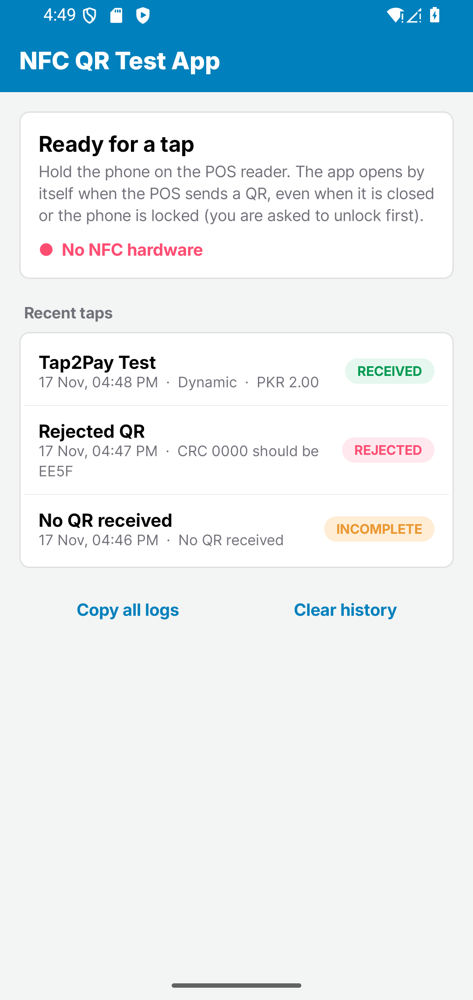
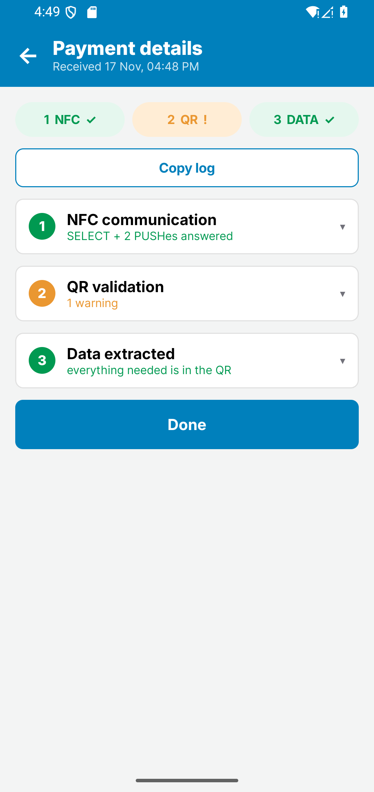

# NFC QR Test App

An Android test app for the phone side of a Tap2Pay NFC transaction. It behaves like a customer bank app: it receives a Raast QR payload from a POS over NFC, records the APDU exchange, validates the QR, and shows the payment data that a bank app would read. **It does not make a payment.**

For a screen-by-screen walkthrough, see the [User Guide](docs/USER_GUIDE.md) or its [Word version](docs/NFC_QR_Test_App_User_Guide.docx). The [technical specification and scenario matrix](bank-app/README.md) are for developers and testers.

## What you need

- An Android phone with NFC and Host Card Emulation (HCE), running Android 8.0 (API 26) or newer. The app installs on devices without NFC but cannot receive a tap there.
- A Tap2Pay-compatible POS or test reader that sends a Raast QR through the Tap2Pay AID.
- To build from source: JDK 17, Android SDK platform 33, and the Android build tools. The repository includes a Gradle wrapper.

The app and another bank/test app may register the same AID. If the home screen says taps are routed elsewhere, disable or uninstall the other app before testing.

## Build and install

1. Clone this repository.
2. Make the Android SDK available through `ANDROID_HOME` or a local `local.properties` file containing `sdk.dir=/path/to/Android/sdk`.
3. Set JDK 17. The checked-in `gradle.properties` contains a macOS Homebrew JDK path. If your JDK is elsewhere, change or remove its `org.gradle.java.home` line, or override it on the Gradle command line.
4. From the repository root, run:

   ```bash
   ./gradlew :core:test :bank-app:assembleDebug
   ```

   On Windows, run `gradlew` from Git Bash (there is no `gradlew.bat`). For example:

   ```bash
   ./gradlew "-Dorg.gradle.java.home=C:/Program Files/Microsoft/jdk-17" :core:test :bank-app:assembleDebug
   ```

5. Install `bank-app/build/outputs/apk/debug/bank-app-debug.apk` on the phone, or use:

   ```bash
   adb install -r bank-app/build/outputs/apk/debug/bank-app-debug.apk
   ```

## First tap

1. Turn on NFC and open **NFC QR Test App**. Confirm the home screen says taps reach this app.
2. Start a Tap2Pay QR test on the POS and hold the phone against its NFC reader.
3. An accepted QR opens **Payment details**. If the phone is locked, unlock it when prompted. Rejected or interrupted taps stay under **Recent taps**.
4. Open **NFC communication**, **QR validation**, and **Data extracted** to inspect the result. Use **Copy log** for one tap or **Copy all logs** on the home screen to share diagnostic text.

**RECEIVED** means the QR passed the phone's acceptance check; other QR fields may still have warnings. **REJECTED** means the QR failed that check. **INCOMPLETE** means no complete QR reached the phone. See the [guide](docs/USER_GUIDE.md#understand-the-results) for details.

## Screenshots

 

These are app screens captured on an Android emulator with synthetic test data. The emulator has no NFC hardware; a physical NFC phone is needed to test an actual tap. More images appear in the [User Guide](docs/USER_GUIDE.md#screens-at-a-glance).

## Project layout

| Module | Purpose |
| --- | --- |
| `core` | Plain Java NFC, QR, validation, reporting, history, and unit tests. |
| `bank-app` | Android HCE service and user interface. |

## License

The app source code is licensed under the [GNU Affero General Public License version 3](LICENSE). Bundled Inter fonts in `bank-app/src/main/assets/fonts/` have a separate [SIL Open Font License version 1.1](third_party/Inter-LICENSE.txt).
