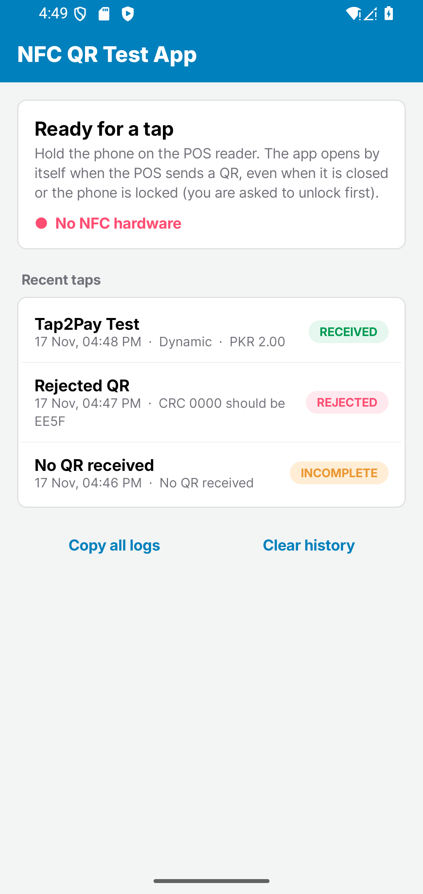
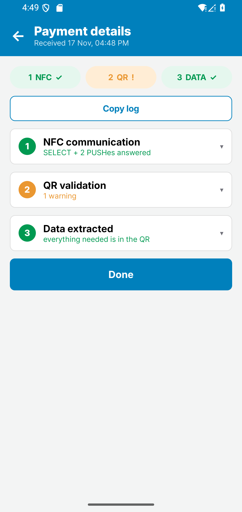
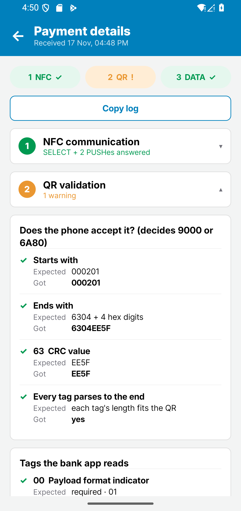

# NFC QR Test App User Guide

This guide helps a tester install the NFC QR Test App, perform a Tap2Pay phone-side test, and understand the result. The app records what a POS sends to a phone over NFC and checks the Raast QR payload. It does not submit or complete a payment.

## Before you start

- Use an Android 8.0 (API 26) or newer phone with **NFC and Host Card Emulation**. An emulator can display the app but cannot perform a physical NFC tap.
- Have a Tap2Pay-compatible POS or test reader that can send a Raast QR over NFC.
- Turn on NFC in Android Settings. Unlock the phone for the first test.
- If another bank or test app registers the same Tap2Pay AID, disable or uninstall it so Android can route the tap to this app. The home screen warns about a competing service.

## Install the app

The repository does not contain a prebuilt APK. Build a debug APK from the repository root:

1. Install JDK 17 and Android SDK platform 33. Set `ANDROID_HOME` to the SDK directory, or create `local.properties` with `sdk.dir=/path/to/Android/sdk`.
2. The checked-in `gradle.properties` points to a Homebrew JDK on macOS. If your JDK is elsewhere, change or remove `org.gradle.java.home`, or override it on the command line.
3. Run `./gradlew :core:test :bank-app:assembleDebug`. On Windows, use Git Bash for `gradlew`; the repository has no `gradlew.bat`. An override can look like `./gradlew "-Dorg.gradle.java.home=C:/Program Files/Microsoft/jdk-17" :core:test :bank-app:assembleDebug` with your actual JDK path.
4. Install `bank-app/build/outputs/apk/debug/bank-app-debug.apk` on the phone. With USB debugging enabled, run `adb install -r bank-app/build/outputs/apk/debug/bank-app-debug.apk`.

## Run your first test

1. Open **NFC QR Test App**. Check the status in the **Ready for a tap** card. It should say **NFC on, Tap2Pay taps reach this app**.
2. Start the Tap2Pay QR flow on the POS. Hold the phone's NFC area against the POS reader until the exchange ends.
3. For an accepted QR, the app opens **Payment details** automatically. If the phone is locked, unlock it when prompted. A rejected QR or a tap that stops before the QR arrives remains in **Recent taps**; tap its row to inspect it.
4. Review the three sections on the details screen. Tap a numbered chip or section header to open it. All sections start collapsed.
5. To capture evidence, tap **Copy log** on a detail screen or **Copy all logs** on the home screen, then paste the text into your test record. The log can include the QR and payment account fields, so review it before sharing.

## Understand the results

| Label or section | What it tells you |
| --- | --- |
| **RECEIVED** | The phone accepted the QR payload. This does not mean a payment occurred or that every QR field is ideal. |
| **REJECTED** | The phone refused a complete QR, for example because its CRC is wrong. Open the row to see the reason. |
| **INCOMPLETE** | The POS sent no complete QR before the NFC session ended. Open the row to inspect the APDUs that arrived. |
| **1 NFC communication** | Shows each SELECT and PUSH APDU, the phone's answer, and expected versus received fields. |
| **2 QR validation** | Checks QR acceptance and tag content. A warning can appear even for a received QR. |
| **3 Data extracted** | Shows merchant, amount, account, and reference data that a bank app would use. |

Green indicates an OK check, orange a warning, and red a problem. Follow the specific explanation in the expanded section rather than relying on the color alone. **Done** returns to the home screen. **Clear history** deletes the saved tap list; the app keeps up to 30 recent taps.

## Screens at a glance

The images below are live app screenshots captured on an Android emulator with **synthetic test taps**. The emulator has no NFC hardware, so its red status line is expected. Use a physical NFC phone to verify real tap routing and APDUs.

### Recent taps

The home screen shows routing status, recent outcomes, **Copy all logs**, and **Clear history**.

### Payment details

Open a section header or chip to see its checks. In this example the NFC exchange is OK and the synthetic QR has one warning.

### QR validation

Each row compares an expected value with the value received from the POS. Scroll to review the remaining tags and raw QR.

## Troubleshooting

| Symptom | What to check |
| --- | --- |
| **No NFC hardware** | Use a physical phone with NFC and HCE. An emulator cannot perform this tap test. |
| **NFC is off** | Turn on NFC in Android Settings and reopen the app. |
| **Taps are not routed to this app** | Disable the other app registered for the same AID. Recheck the home screen before retrying. |
| **The app does not open after a tap** | Check **Recent taps**. Rejected and incomplete taps do not auto-open. If a received tap is listed, open it manually and inspect the NFC log; Android may have blocked the background launch. |
| **Rejected QR** | Open the row and inspect the rejection reason and **QR validation**. Compare the POS payload and CRC with the values shown. |
| **Incomplete tap** | Keep the phone on the reader until the POS finishes. Open **NFC communication** to see whether SELECT or PUSH messages were missing. |
| **QR warning or missing payment data** | Open **QR validation** and **Data extracted** to identify the tag or field that needs correction on the POS side. |
| **Build fails before compilation** | Confirm JDK 17, Android SDK platform 33, and the `org.gradle.java.home` path. On Windows use Git Bash for `gradlew`. |

For protocol behavior, APDU details, and the full test scenario matrix, see [the technical README](../bank-app/README.md). For the short project overview and source layout, see [the repository README](../README.md).
